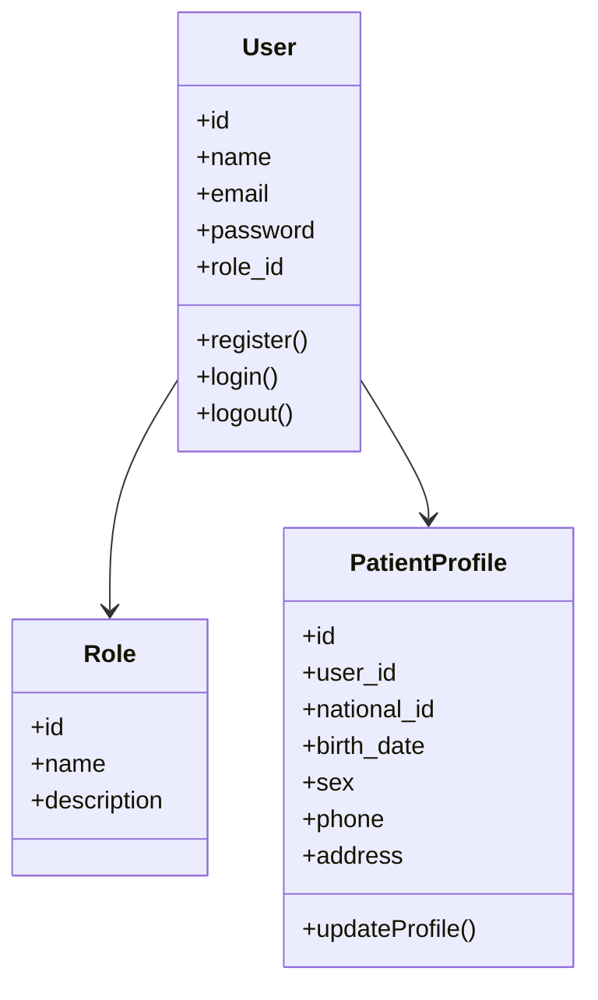
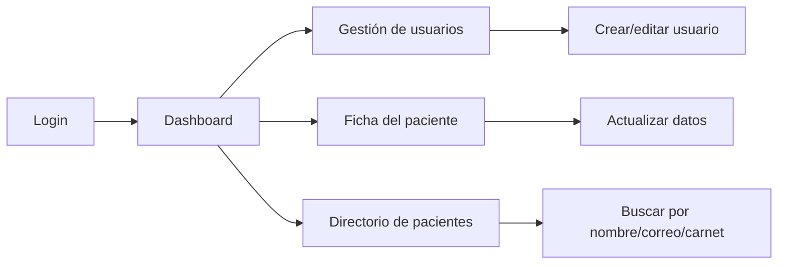

# 3.2 Sprint 1

## 3.2.1 Sprint Planning (Objetivo del Sprint)

El Sprint 1 del proyecto “Sistema Web para la Gestión y Control de la Información del Centro de Salud San Juan” tuvo como objetivo principal establecer la base funcional del sistema, enfocándose en la autenticación de usuarios y la gestión de fichas de pacientes. Durante esta iteración se desarrollaron los módulos esenciales para que el sistema permita registrar usuarios con roles, autenticar sesiones, crear y actualizar fichas, y consultar pacientes desde el panel administrativo y médico.

El alcance previsto del sprint incluyó:

- Autenticación segura de usuarios.
- Gestión de roles y permisos.
- Registro de pacientes y creación de ficha.
- Actualización de la ficha por parte del paciente.
- Búsqueda y filtrado de pacientes.

El objetivo general fue dejar una base operativa, segura y validada para continuar con el Sprint 2, donde se incluirán especialidades, horarios y citas médicas.

## 3.2.2 Sprint Backlog (Tareas, responsables, tiempo)

| Historia de Usuario | Descripción | Responsable | Tiempo estimado |
|---|---|---|---:|
| HU01 - Autenticación | Login, logout, manejo de sesión y validación de credenciales | Equipo backend + frontend | 3 días |
| HU02 - Gestión de Roles | CRUD de usuarios y asignación de roles | Administrador del sistema / backend | 5 días |
| HU03 - Registro de Paciente | Registro de cuenta y ficha clínica básica | Backend + UX | 5 días |
| HU04 - Modificación de Ficha | Actualización de datos del paciente | Backend + frontend | 5 días |
| HU05 - Búsqueda de Pacientes | Búsqueda por nombre, correo y carnet con filtros | Backend + frontend | 3 días |

### Distribución de tiempo por tarea

| Fase | Tiempo estimado |
|---|---:|
| Planificación y análisis | 2 días |
| Desarrollo backend | 8 días |
| Desarrollo frontend | 5 días |
| Pruebas y validación | 3 días |
| Ajustes finales | 2 días |
| Total | 20 días |

## 3.2.3 Diagramas de clase e interfaces

### Diagrama de clases



### Diagrama de interfaces principales



### Interfaz sugerida

- Login con correo y contraseña.
- Panel principal según rol (paciente, médico, administrador).
- Gestión de usuarios con creación, edición y eliminación.
- Perfil del paciente con datos personales y contacto.
- Directorio con filtros por sexo y búsqueda textual.

## 3.2.4 Daily Meeting

Durante el Sprint 1 se realizaron reuniones diarias de 15 minutos para revisar el avance del proyecto, detectar bloqueos y coordinar tareas del día.

### Ejemplo de agenda diaria

| Día | Tema principal | Resultado |
|---|---|---|
| Lunes | Definición de alcance del sprint | Se acordó el backlog y responsabilidades. |
| Martes | Inicio de autenticación y roles | Se completó la base del login y permisos. |
| Miércoles | Desarrollo de registro de paciente | Se validó creación de ficha y control de datos. |
| Jueves | Modificación de perfil y búsqueda | Se avanzó en actualización y filtros. |
| Viernes | Pruebas y correcciones | Se ajustaron errores y se validó la entrega del sprint. |

### Principales observaciones del Daily Meeting

- Se priorizó la resolución de bloqueos de validación en formularios.
- Se coordinó la integración entre backend y frontend.
- Se identificó la necesidad de proteger rutas por rol y evitar cambios no autorizados.
- Las pruebas se ejecutaron en cada etapa para asegurar estabilidad.

## 3.2.5 Scrumboard (ToDo, Doing, Done) - Inicial y final por cada Historia de Usuario

### Scrumboard inicial

| Historia | ToDo | Doing | Done |
|---|---|---|---|
| HU01 Autenticación | Definir login y sesión | Validación de credenciales | - |
| HU02 Gestión de Roles | CRUD de usuarios | Permisos y validación | - |
| HU03 Registro de Paciente | Registro de cuenta | Ficha del paciente | - |
| HU04 Modificación de Ficha | Perfil editable | Validaciones de datos | - |
| HU05 Búsqueda de Pacientes | Diseño de filtros | Lógica de consultas | - |

### Scrumboard final

| Historia | ToDo | Doing | Done |
|---|---|---|---|
| HU01 Autenticación | - | - | Login, logout, validación, manejo de sesión e intentos |
| HU02 Gestión de Roles | - | - | CRUD completo y protección por rol |
| HU03 Registro de Paciente | - | - | Registro con ficha y validación transaccional |
| HU04 Modificación de Ficha | - | - | Actualización segura de datos del paciente |
| HU05 Búsqueda de Pacientes | - | - | Filtros, búsqueda y paginación de resultados |

## 3.2.5 Product Increment

El Product Increment entregado al final del Sprint 1 incluye las siguientes funcionalidades operativas:

- Sistema de autenticación con inicio y cierre de sesión.
- Gestion de usuarios y asignación de roles (administrador, médico, paciente).
- Registro de pacientes con validación de datos personales.
- Actualización de ficha de paciente desde su perfil.
- Búsqueda y consulta de pacientes con filtros por sexo.
- Interfaz de usuario en español con mensajes de validación y respuestas claras.

Este incremento deja la plataforma en una etapa usable y válida para continuar con el siguiente sprint, donde se trabajará en atención médica y citas.

## 3.2.6 Burndown y Burnup

### Tabla de burndown

| Día | Story Points restantes | Story Points completados |
|---|---:|---:|
| Día 1 | 21 | 0 |
| Día 2 | 18 | 3 |
| Día 3 | 13 | 8 |
| Día 4 | 9 | 12 |
| Día 5 | 5 | 16 |
| Día 6 | 2 | 19 |
| Día 7 | 0 | 21 |

### Interpretación

- El sprint inició con 21 story points pendientes.
- El progreso fue constante durante la iteración hasta completar la totalidad del alcance.
- La curva de burndown mostró una tendencia estable hacia cero, evidenciando control del backlog y cumplimiento del objetivo.

### Burnup (puntos completados acumulados)

```mermaid
lineChart
    title Burnup del Sprint 1
    x-axis [D1, D2, D3, D4, D5, D6, D7]
    y-axis "Story Points"
    line 1: [0, 3, 8, 12, 16, 19, 21]
    line 2: [0, 3, 8, 12, 16, 19, 21]
```

## 3.2.7 Sprint Review

La reunión de Sprint Review se centró en la validación del incremento entregado. Se mostró al cliente o stakeholders la funcionalidad implementada y se verificó que las cinco historias de usuario del sprint estaban completadas.

### Puntos destacables de la revisión

- Se validó la autenticación segura y el control de roles.
- Se revisó el proceso de registro de paciente y la gestión de fichas.
- Se confirmaron las búsquedas y filtros de pacientes.
- Se constató que el sistema cuenta con una base funcional para continuar al siguiente sprint.

### Decisión del review

El sprint fue aceptado con resultados satisfactorios. Se identificó que el siguiente paso lógico es iniciar el Sprint 2 para desarrollar personal médico, especialidades y programación de citas.

## 3.2.8 Sprint Retrospective

La retrospectiva del Sprint 1 tuvo como objetivo evaluar qué funcionó bien, qué se puede mejorar y qué acciones se deben aplicar en el siguiente sprint.

### Lo que funcionó bien

- La división del trabajo por historias de usuario fue clara.
- La priorización de autenticación y gestión de roles permitió una base sólida.
- Se realizaron pruebas recurrentes que redujeron errores finales.
- La comunicación diaria ayudó a identificar bloqueos rápidamente.

### Lo que se puede mejorar

- Definir mejor los tiempos de cada tarea desde el inicio del sprint.
- Mejorar la documentación técnica de las funcionalidades implementadas.
- Reducir el tiempo de ajuste en validaciones de formularios antes de la prueba final.

### Acciones para el siguiente sprint

- Mantener reuniones diarias de follow-up con tiempos estrictos.
- Establecer pruebas más detalladas de integración para cada historia.
- Documentar claramente las reglas de negocio por rol y permisos.

## Conclusión

El Sprint 1 se desarrolló de forma satisfactoria y permitió construir la base esencial del sistema de salud. Se cumplieron los objetivos planteados, se entregó un incremento funcional y se dejaron definidas las bases para el siguiente sprint, centrado en atención médica, disponibilidad, citas y agenda.
