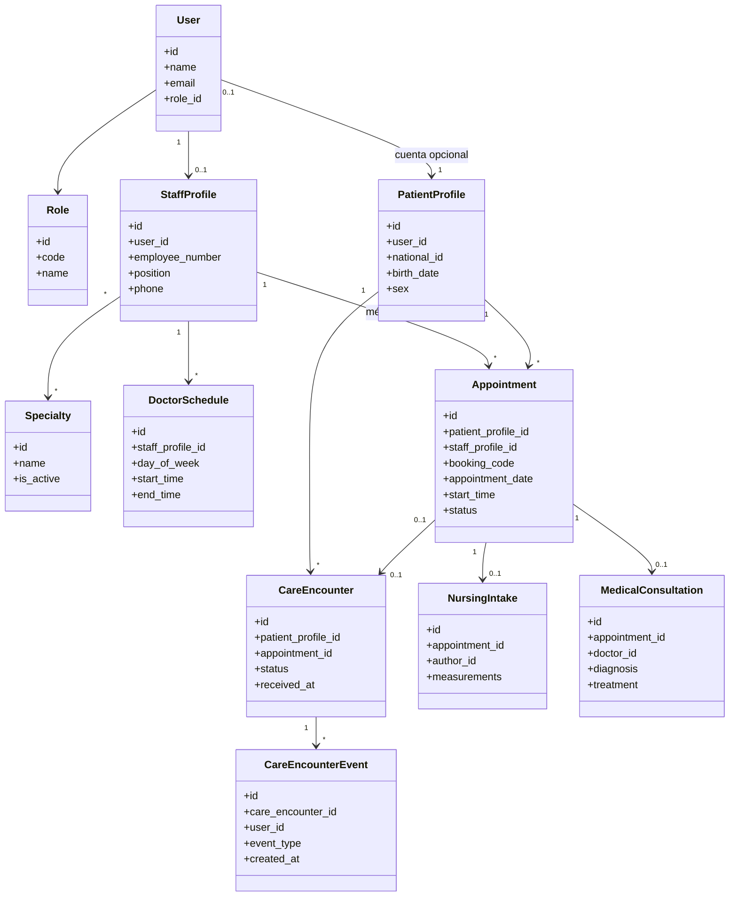
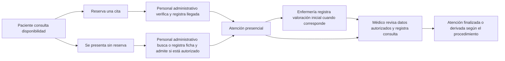

# 3.3 Sprint 2

## 3.3.1 Sprint Planning (Objetivo del Sprint)

El Sprint 2 del proyecto “Sistema Web para la Gestión y Control de la Información del Centro de Salud San Juan” reúne en una sola iteración el trabajo que anteriormente estaba descrito en los Sprints 2, 3 y 4. Su objetivo es completar el ciclo de atención: desde la organización del personal, las especialidades y las citas hasta la admisión presencial, la valoración inicial de enfermería y la consulta médica.

El alcance se organiza en tres etapas relacionadas:

1. **Organización y reserva:** gestión de personal y especialidades, configuración de horarios, consulta de disponibilidad y reserva de citas.
2. **Valoración y consulta clínica:** registro inicial de enfermería, acceso autorizado al historial y documentación de la consulta médica.
3. **Admisión y seguimiento presencial:** verificación de reservas, registro de llegada, recepción de pacientes sin reserva cuando el centro lo autorice y trazabilidad del recorrido de atención.

La reserva de una cita, la admisión presencial y la atención clínica son procesos distintos. Una reserva no significa que el paciente llegó y la llegada no significa que la consulta ya se realizó. La atención urgente se rige por el protocolo institucional y no debe retrasarse por la falta de una reserva.

El alcance implementado contempla:

- Administración de médicos, personal de enfermería y personal administrativo mediante cuentas y perfiles laborales.
- Gestión de especialidades y asignación a médicos.
- Configuración de horarios semanales y consulta de bloques disponibles.
- Reserva, confirmación, cancelación y consulta de citas, además de la agenda diaria del médico.
- Registro administrativo de citas presenciales para pacientes existentes.
- Acceso autorizado al historial y registro de consultas médicas.
- Captura de motivo referido y mediciones iniciales por enfermería, con consulta para el médico responsable y rectificaciones trazables.
- Admisión de pacientes con reserva y registro de llegada por personal autorizado.
- Atención presencial sin reserva, sin crear una cita ficticia ni exigir una cuenta de portal.
- Separación entre la ficha del paciente, su cuenta opcional, la reserva y la atención presencial.
- Registro de eventos relevantes para mantener la trazabilidad de la atención.

**Responsable de admisión:** el rol operativo es **Personal administrativo** (`staff`); el administrador también puede realizar las operaciones autorizadas. El rol histórico `receptionist` se conserva para compatibilidad con cuentas ya existentes.

**Pendiente externo:** la historia HU14, relacionada con reportes SNIS, requiere confirmar con el SEDES los formatos, variables y mecanismos de entrega. No se considera implementada por este sprint.

## 3.3.2 Sprint Backlog (Tareas, responsables, tiempo)

Las historias HU06–HU21 mantienen sus identificadores para facilitar la trazabilidad con los documentos y pruebas existentes. Las estimaciones siguientes provienen de la planificación previa de cada etapa: al consolidarlas no constituyen una nueva estimación de capacidad ni una promesa de duración para el sprint unificado.

| Historia de Usuario | Descripción | Responsable | Story Points de referencia |
|---|---|---|---:|
| HU06 - Registro de Personal | Administrar cuentas, roles y datos laborales del personal | Administración + backend + frontend | 5 |
| HU07 - Gestión de Especialidades | Mantener especialidades y asignarlas a médicos | Administración + backend | 3 |
| HU08 - Visualización de Disponibilidad | Consultar médicos, especialidades y horarios disponibles | Backend + frontend | 5 |
| HU09 - Programación de Cita - Paciente | Reservar, confirmar, cancelar y consultar citas propias | Backend + frontend | 8 |
| HU10 - Programación de Cita - Administración | Registrar citas presenciales para pacientes existentes | Administración + backend + frontend | 5 |
| HU11 - Consulta de Agenda | Consultar la agenda diaria del médico autenticado | Backend + frontend | 3 |
| HU12 - Acceso a Historial Clínico | Consultar antecedentes con acceso restringido | Backend + frontend | 5 |
| HU13 - Registro de Consulta | Registrar la valoración y las indicaciones médicas | Médico + backend + frontend | 13 |
| HU14 - Reportes SNIS | Exportar reportes conforme a la especificación oficial | Administración + backend | 8 |
| HU15 - Reportes Institucionales | Consultar y exportar estadísticas administrativas agregadas | Administración + backend + frontend | 5 |
| HU16 - Recepción de Enfermería | Registrar datos iniciales y comunicarles al médico responsable | Enfermería + backend + frontend | 6 |
| HU17 - Admisión y Registro de Llegada | Buscar reservas, verificar datos administrativos y registrar llegada | Personal administrativo + backend + frontend | 8 |
| HU18 - Atención Presencial sin Reserva | Buscar o crear una ficha y abrir atención sin cita cuando esté autorizada | Personal administrativo + backend + frontend | 13 |
| HU19 - Flujo y Estados de Atención | Controlar el avance por recepción, enfermería y consulta | Backend + enfermería + medicina | 8 |
| HU20 - Integración Clínica por Atención | Asociar enfermería y consulta a una atención con o sin cita | Backend + enfermería + medicina | 13 |
| HU21 - Identificación y Consulta de Reserva | Proporcionar código de reserva y permitir identificar sus datos y estado | Backend + frontend | 5 |
| **Total de referencia** | **Suma de estimaciones previas; requiere reestimación para un único sprint** |  | **113** |

La planificación original del Sprint 2 estimaba 22 días de referencia para HU06–HU11. No se asigna una duración total a esta consolidación porque las historias HU12–HU21 se planificaron en etapas distintas y la capacidad disponible del equipo debe acordarse antes de ejecutar el sprint.

### Dependencias y restricciones

- HU08 y HU09 dependen de la configuración de horarios y especialidades de HU06–HU07.
- HU12 y HU13 dependen de la identificación correcta del paciente y de controles de acceso por rol.
- HU16 registra datos iniciales; no sustituye ni modifica la valoración médica de HU13.
- HU17–HU20 comparten el concepto de atención presencial y deben conservar la relación entre paciente, reserva opcional, personal responsable y registros clínicos.
- La admisión sin reserva depende de la autorización y las reglas operativas del centro.
- HU14 permanece pendiente de especificación oficial del SEDES.

## 3.3.3 Diagramas de clase e interfaces

### Diagrama de clases

La ficha del paciente puede existir sin una cuenta de acceso. Una atención puede estar relacionada con una cita o ser presencial sin reserva. Los registros clínicos deben conservar su vínculo con el paciente y la atención correspondiente.

### Diagrama del flujo de atención

### Interfaces implementadas

- Gestión administrativa de personal, especialidades y disponibilidad semanal.
- Búsqueda de horarios y reserva de citas por parte del paciente.
- Consulta de citas propias, código de reserva y estado disponible.
- Registro administrativo de citas presenciales.
- Agenda diaria del médico y acceso autorizado al historial clínico.
- Formularios de enfermería para registrar motivo, mediciones y observaciones iniciales.
- Consulta por el médico responsable y rectificaciones de registros de enfermería con motivo.
- Panel de admisión para el personal administrativo.
- Búsqueda de reservas, verificación y registro de llegada.
- Registro de atenciones sin reserva cuando el centro habilita ese flujo.
- Historial de atenciones y eventos asociados.

### Funciones del cargo de enfermería

El personal de enfermería participa en la valoración inicial del paciente y comunica al profesional médico la información pertinente. En el sistema puede:

- Consultar la cola diaria de pacientes dentro del alcance de sus permisos.
- Registrar el motivo referido y las mediciones que efectivamente tomó.
- Registrar, cuando corresponda, presión sistólica y diastólica, pulso, temperatura, frecuencia respiratoria, saturación de oxígeno, peso y talla.
- Añadir observaciones breves relacionadas con la recepción inicial.
- Rectificar una captura mediante una nueva versión que indique el motivo, conservando el registro previo.

Los datos pueden quedar opcionales cuando no fueron medidos; el sistema no debe inventar valores ni interpretarlos como diagnóstico. Enfermería no registra ni modifica diagnósticos, tratamientos o recomendaciones médicas. El médico autorizado consulta la información vinculada a sus pacientes según las reglas de acceso.

## 3.3.4 Daily Meeting

La siguiente agenda es una referencia para organizar el seguimiento del sprint unificado; no constituye un registro histórico de reuniones realizadas.

| Jornada o fase | Tema principal | Resultado esperado |
|---|---|---|
| Planificación | Revisar historias, dependencias, roles y capacidad | Acordar alcance y criterios de aceptación |
| Modelado | Revisar pacientes, cuentas, citas y atenciones | Preservar relaciones y evitar duplicidad de fichas |
| Agenda y reservas | Validar horarios, disponibilidad y estados de citas | Evitar reservas duplicadas y proteger las citas propias |
| Enfermería e historial | Revisar captura, acceso clínico y rectificaciones | Mantener autoría y separar funciones clínicas |
| Admisión | Validar búsqueda, llegada y atención sin reserva | Registrar ingreso sin crear citas ficticias |
| Integración y pruebas | Recorrer el flujo completo por rol | Resolver defectos y verificar transiciones |
| Cierre | Demostrar el incremento y registrar pendientes | Confirmar alcance entregado y decisiones restantes |

### Puntos de seguimiento

- Confirmar que cada rol solo acceda a las operaciones que le corresponden.
- Evitar reservas simultáneas del mismo bloque horario.
- Asegurar que el paciente solo consulte sus propias reservas.
- Mantener separadas la reserva, la llegada y la consulta médica.
- Evitar duplicar pacientes al admitir a una persona que no tiene cuenta web.
- Verificar que las rectificaciones clínicas no eliminen el contenido anterior.
- Confirmar con el SEDES los requisitos de HU14 antes de implementar reportes SNIS.

## 3.3.5 Scrumboard (ToDo, Doing, Done) - Inicial y final por cada Historia de Usuario

### Scrumboard inicial de referencia

| Historia | ToDo | Doing | Done |
|---|---|---|---|
| HU06 Registro de Personal | Definir cargos y datos laborales | Diseñar cuentas y permisos | - |
| HU07 Gestión de Especialidades | Crear catálogo | Asignar especialidades a médicos | - |
| HU08 Visualización de Disponibilidad | Definir filtros y horarios | Calcular bloques libres | - |
| HU09 Cita del Paciente | Diseñar reserva y estados | Confirmación y cancelación | - |
| HU10 Cita de Administración | Diseñar agendamiento presencial | Validar paciente y horario | - |
| HU11 Consulta de Agenda | Diseñar agenda diaria | Limitar consulta al médico autenticado | - |
| HU12 Historial Clínico | Definir acceso autorizado | Relacionar antecedentes con paciente | - |
| HU13 Registro de Consulta | Definir campos clínicos | Validar profesional y cita | - |
| HU14 Reportes SNIS | Obtener especificación del SEDES | Definir variables y formato | - |
| HU15 Reportes Institucionales | Definir indicadores agregados | Preparar consulta y exportación | - |
| HU16 Recepción de Enfermería | Definir mediciones y permisos | Captura y rectificación trazable | - |
| HU17 Admisión y Llegada | Definir verificación de reservas | Registrar llegada con auditoría | - |
| HU18 Atención sin Reserva | Definir reglas institucionales | Evitar citas ficticias y duplicados | - |
| HU19 Estados de Atención | Acordar transiciones válidas | Integrar los pasos del proceso | - |
| HU20 Integración Clínica | Definir vínculo entre atención y registros | Integrar enfermería y consulta | - |
| HU21 Identificación de Reserva | Definir código y consulta de estado | Integrar código único a las citas | - |

### Scrumboard final según el alcance implementado

| Historia | ToDo | Doing | Done |
|---|---|---|---|
| HU06 Registro de Personal | - | - | Perfiles laborales, cuentas y roles de personal |
| HU07 Gestión de Especialidades | - | - | Catálogo y asignación de especialidades |
| HU08 Visualización de Disponibilidad | - | - | Consulta por fecha, especialidad y bloques disponibles |
| HU09 Cita del Paciente | - | - | Reserva, confirmación, cancelación y consulta de citas propias |
| HU10 Cita de Administración | - | - | Registro de citas presenciales para pacientes existentes |
| HU11 Consulta de Agenda | - | - | Agenda diaria restringida al médico autenticado |
| HU12 Historial Clínico | - | - | Consulta de antecedentes según autorización |
| HU13 Registro de Consulta | - | - | Registro médico asociado a la atención correspondiente |
| HU14 Reportes SNIS | Especificación oficial del SEDES | - | - |
| HU15 Reportes Institucionales | - | - | Reportes administrativos agregados y exportación disponible |
| HU16 Recepción de Enfermería | - | - | Captura inicial y rectificaciones trazables |
| HU17 Admisión y Llegada | - | - | Búsqueda de reservas y registro de llegada |
| HU18 Atención sin Reserva | - | - | Flujo presencial sin cita ficticia ni cuenta obligatoria |
| HU19 Estados de Atención | - | - | Seguimiento de estados y operaciones autorizadas |
| HU20 Integración Clínica | - | - | Atención común para admisión, enfermería y consulta |
| HU21 Identificación de Reserva | - | - | Código único asociado a la reserva |

HU14 permanece pendiente porque depende de requisitos externos que todavía deben confirmarse. La aceptación de los procesos clínicos y administrativos por parte del centro también debe realizarse conforme a sus protocolos internos.

## 3.3.6 Product Increment

El incremento integrado de este sprint comprende:

- Personal con perfiles laborales y permisos por rol.
- Especialidades, disponibilidad médica y horarios semanales.
- Reservas de pacientes y citas presenciales administrativas.
- Agenda diaria del médico y acceso restringido a los antecedentes pertinentes.
- Registro de consultas médicas asociado al paciente y a la atención.
- Captura inicial de enfermería con mediciones opcionales, autoría y rectificaciones trazables.
- Admisión por personal administrativo, verificación de reservas y registro de llegada.
- Atención sin reserva cuando está habilitada, sin generar una cita ficticia ni exigir una cuenta de portal.
- Registro de eventos y estados para distinguir reserva, admisión y atención clínica.
- HU14 identificada como pendiente de especificación oficial del SEDES.

### Reglas funcionales y de seguridad

1. Cada cita y cada atención deben poder identificarse de forma única.
2. La disponibilidad se valida al guardar la reserva para evitar asignaciones duplicadas.
3. La reserva no equivale a llegada ni a consulta realizada.
4. Los cambios administrativos relevantes deben registrar quién los realizó y cuándo.
5. El paciente solo consulta sus propias citas y datos autorizados.
6. El personal administrativo realiza admisión, pero no accede a diagnósticos por el solo hecho de cumplir funciones administrativas.
7. Enfermería registra datos iniciales dentro de sus permisos; el diagnóstico y el tratamiento corresponden al profesional médico.
8. Las rectificaciones conservan el contenido previo y registran autor, fecha y motivo.
9. La atención sin reserva no exige crear una cita ficticia ni una cuenta de paciente.
10. Se deben buscar posibles coincidencias antes de crear una nueva ficha de paciente.
11. La prioridad clínica definida por el protocolo institucional prevalece sobre el orden ordinario de las citas.
12. El sistema no diagnostica, prescribe ni asigna prioridades clínicas automáticamente.
13. La falta de reserva no debe retrasar la atención de emergencia.
14. El acceso a datos personales y clínicos debe limitarse por rol y mantenerse trazable.

### Criterios de aceptación

- Una reserva activa no se ofrece nuevamente como horario disponible.
- Solo el paciente titular puede consultar o gestionar su reserva en el portal.
- Personal administrativo autorizado puede verificar una reserva y registrar la llegada sin marcar automáticamente la consulta como atendida.
- Una atención sin cita puede relacionarse con una ficha existente o con una nueva ficha autorizada, sin requerir cuenta web.
- Enfermería puede registrar las mediciones válidas efectivamente tomadas, sin introducir campos de diagnóstico médico.
- El médico responsable puede consultar los datos iniciales necesarios para su atención.
- La consulta médica se registra separadamente de la admisión y de la recepción de enfermería.
- Los cambios de estado y las rectificaciones conservan la trazabilidad correspondiente.
- Las reservas canceladas o las inasistencias no aparecen como consultas médicas atendidas.

## 3.3.7 Burndown y Burnup

La suma de 113 Story Points conserva estimaciones elaboradas en planificaciones diferentes; no es una reestimación del sprint unificado. La siguiente tabla es únicamente un ejemplo de formato y no representa trabajo medido ni avance real.

### Tabla de burndown ilustrativa

| Día | Story Points restantes | Story Points completados |
|---|---:|---:|
| Día 1 | 113 | 0 |
| Día 2 | 96 | 17 |
| Día 3 | 79 | 34 |
| Día 4 | 62 | 51 |
| Día 5 | 45 | 68 |
| Día 6 | 28 | 85 |
| Día 7 | 11 | 102 |
| Día 8 | 0 | 113 |

### Interpretación

El burndown muestra el trabajo pendiente y el burnup el trabajo completado respecto del alcance total. Para el seguimiento real, el equipo debe sustituir estos valores ilustrativos por los puntos estimados y completados en cada jornada, actualizar el alcance cuando cambie y registrar cualquier bloqueo. HU14 no debe contarse como terminado hasta recibir y cumplir la especificación oficial del SEDES.
