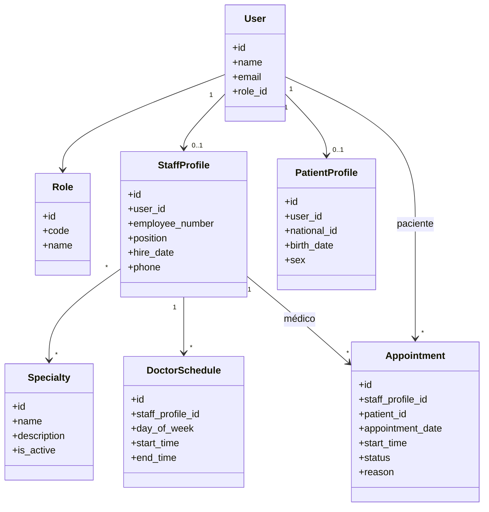
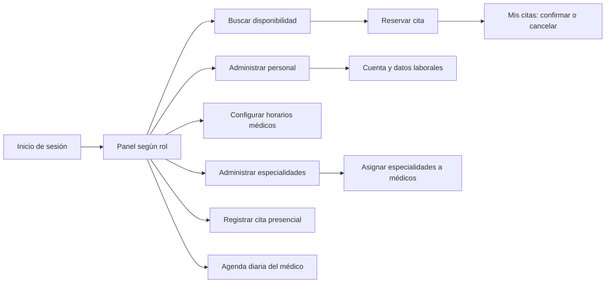
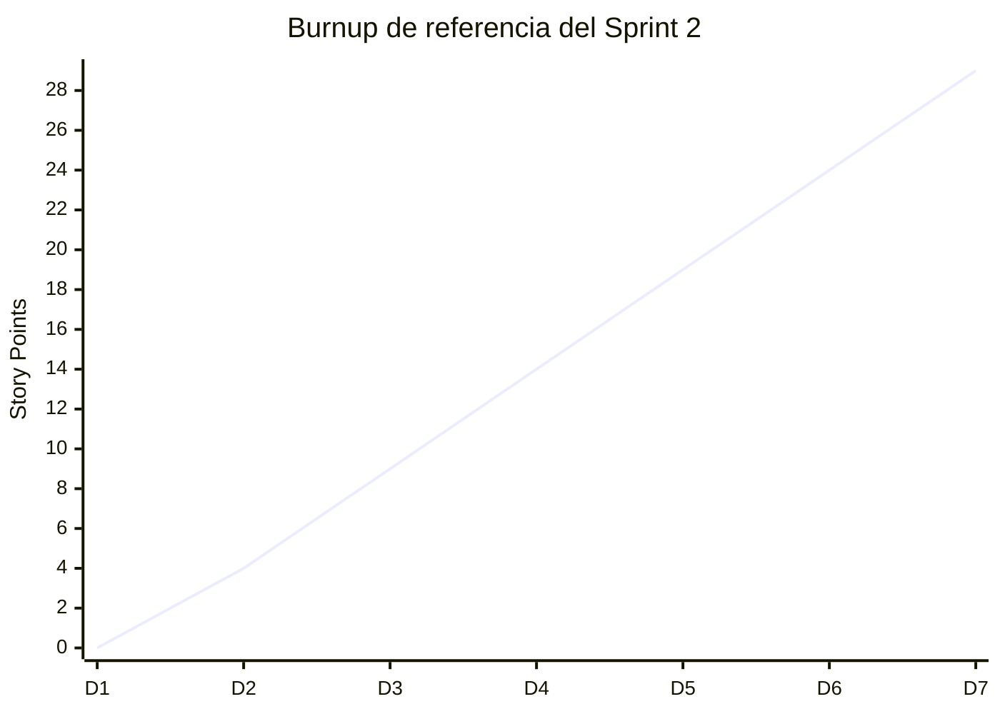

# 3.3 Sprint 2

## 3.3.1 Sprint Planning (Objetivo del Sprint)

El Sprint 2 del proyecto “Sistema Web para la Gestión y Control de la Información del Centro de Salud San Juan” tuvo como objetivo estructurar la oferta de atención médica y habilitar la programación de citas. El incremento amplía la base del Sprint 1 con la administración del personal, el catálogo de especialidades, los horarios de atención y las agendas de pacientes, médicos y personal administrativo.

El alcance del sprint comprende:

- Registro y mantenimiento de médicos, enfermería y personal administrativo, cada uno con una cuenta de acceso y un rol limitado.
- Creación y mantenimiento del catálogo de especialidades y asignación de una o más especialidades a cada médico.
- Configuración de disponibilidad semanal recurrente en bloques de 30 minutos.
- Consulta de médicos, especialidades y horarios libres por parte del paciente.
- Reserva, confirmación y cancelación de citas por parte del paciente.
- Registro de citas presenciales por parte de la administración.
- Consulta de la agenda diaria del médico autenticado.

Se adoptó como regla funcional que las reservas de pacientes quedan pendientes de confirmación y bloquean el horario; las citas creadas por administración quedan confirmadas. Las horas disponibles se calculan a partir del horario semanal del médico, las citas activas y la fecha seleccionada.

## 3.3.2 Sprint Backlog (Tareas, responsables, tiempo)

| Historia de Usuario | Descripción | Responsable | Story Points |
|---|---|---|---:|
| HU06 - Registro de Personal | CRUD de médicos, enfermería y personal administrativo con cuenta, rol y datos laborales | Administración + backend + frontend | 5 |
| HU07 - Gestión de Especialidades | CRUD del catálogo y asignación de especialidades a médicos | Administración + backend | 3 |
| HU08 - Visualización de Disponibilidad | Búsqueda de especialidades, médicos y horarios libres por fecha | Backend + frontend | 5 |
| HU09 - Programación de Cita - Paciente | Reserva, confirmación, cancelación y consulta de citas propias | Backend + frontend | 8 |
| HU10 - Programación de Cita - Administración | Registro de citas presenciales para pacientes existentes | Administración + backend + frontend | 5 |
| HU11 - Consulta de Agenda | Agenda diaria con datos de pacientes y estado de las citas | Backend + frontend | 3 |
| **Total** |  |  | **29** |

### Distribución de tiempo de referencia

La siguiente distribución es una estimación de planificación y no un registro de horas efectivamente trabajadas.

| Fase | Tiempo estimado |
|---|---:|
| Planificación y análisis | 2 días |
| Modelado y migraciones | 3 días |
| Desarrollo backend | 7 días |
| Desarrollo de vistas e integración | 5 días |
| Pruebas y validación | 3 días |
| Ajustes y revisión | 2 días |
| **Total** | **22 días** |

## 3.3.3 Diagramas de clase e interfaces

### Diagrama de clases

### Diagrama de interfaces principales

### Interfaces implementadas

- Administración de personal con datos laborales, rol, cuenta de acceso y especialidades.
- Catálogo de especialidades con estado activo o inactivo.
- Formulario de disponibilidad semanal, de lunes a domingo, con hora inicial y final.
- Búsqueda de disponibilidad por fecha y especialidad con reservas desde los bloques libres.
- Sección “Mis citas” para revisar el estado y gestionar reservas próximas.
- Formulario administrativo para agendar y confirmar una cita presencial.
- Agenda diaria del médico con hora, paciente, contacto, motivo y estado.

### Funciones del cargo de enfermería

En el funcionamiento del centro de salud, el personal de enfermería apoya la atención y el cuidado de los pacientes. Entre sus responsabilidades habituales se encuentran:

- Recibir y orientar a los pacientes durante su atención.
- Realizar controles básicos, como la toma y el registro de signos vitales, de acuerdo con los protocolos del centro.
- Apoyar la preparación del paciente y del consultorio antes de la consulta.
- Asistir al personal médico durante los procedimientos que correspondan a su formación y protocolos.
- Dar seguimiento a las indicaciones de cuidado y explicar al paciente las recomendaciones autorizadas por el profesional médico.
- Mantener los registros de enfermería que establezca el centro y comunicar al médico información relevante sobre el paciente.
- Aplicar las normas de higiene, bioseguridad y manejo de materiales clínicos.

**Alcance en el sistema de este sprint:** enfermería cuenta con un rol y perfil laboral propios, pero este incremento todavía no incorpora pantallas ni operaciones específicas de enfermería para registrar signos vitales, realizar triaje o actualizar información clínica. Esas funciones requieren definirse e implementarse con sus permisos correspondientes; el acceso de enfermería no equivale al de administración ni al del médico.

## 3.3.4 Daily Meeting

La siguiente agenda sirve como referencia para las reuniones diarias de seguimiento del Sprint 2. No constituye un registro histórico de reuniones realizadas.

### Ejemplo de agenda diaria

| Día | Tema principal | Resultado esperado |
|---|---|---|
| Lunes | Confirmación del backlog y reglas de acceso por rol | Acordar permisos y datos laborales requeridos |
| Martes | Modelo de personal y especialidades | Validar cuentas de personal, relaciones y catálogo |
| Miércoles | Configuración de horarios semanales | Revisar días, intervalos y bloques de 30 minutos |
| Jueves | Disponibilidad y reserva de pacientes | Comprobar filtros, horarios libres y prevención de reservas duplicadas |
| Viernes | Citas presenciales y agenda médica | Validar registro administrativo y consulta diaria |
| Cierre | Pruebas, defectos y demostración del incremento | Resolver incidencias y documentar temas para el siguiente sprint |

### Puntos de seguimiento

- Confirmar que solo administración pueda modificar personal, especialidades y horarios.
- Evitar que pacientes consulten o cancelen citas pertenecientes a otras cuentas.
- Comprobar que una reserva pendiente o confirmada no vuelva a ofrecerse como disponible.
- Verificar que la cancelación libere el bloque y que las citas pasadas no puedan modificarse.
- Mantener las citas asociadas al médico y paciente incluso si se intenta eliminar una cuenta.

## 3.3.5 Scrumboard (ToDo, Doing, Done) - Inicial y final por cada Historia de Usuario

### Scrumboard inicial

| Historia | ToDo | Doing | Done |
|---|---|---|---|
| HU06 Registro de Personal | Definir cargos y datos laborales | Diseñar cuentas y permisos | - |
| HU07 Gestión de Especialidades | Crear catálogo | Asignar especialidades a médicos | - |
| HU08 Visualización de Disponibilidad | Diseñar filtros por fecha y especialidad | Calcular bloques libres | - |
| HU09 Cita del Paciente | Diseñar reserva y estados | Implementar confirmación y cancelación | - |
| HU10 Cita de Administración | Diseñar flujo para atención presencial | Validar paciente y horario | - |
| HU11 Consulta de Agenda | Diseñar agenda por fecha | Mostrar citas del médico autenticado | - |

### Scrumboard final

| Historia | ToDo | Doing | Done |
|---|---|---|---|
| HU06 Registro de Personal | - | - | CRUD de personal con cuentas, roles limitados y datos laborales |
| HU07 Gestión de Especialidades | - | - | CRUD de especialidades y asignación a médicos |
| HU08 Visualización de Disponibilidad | - | - | Consulta por fecha y especialidad con bloques de 30 minutos |
| HU09 Cita del Paciente | - | - | Reserva pendiente, confirmación, cancelación y consulta de citas propias |
| HU10 Cita de Administración | - | - | Registro administrativo de citas confirmadas para pacientes existentes |
| HU11 Consulta de Agenda | - | - | Agenda diaria restringida al médico autenticado |

## 3.3.6 Product Increment

El incremento implementado para el Sprint 2 incorpora:

- Perfiles laborales relacionados con cuentas de usuario y roles separados para médicos, enfermería y personal administrativo.
- Gestión de especialidades activas e inactivas y asignación de especialidades a los médicos.
- Horarios semanales recurrentes con intervalos de 30 minutos.
- Disponibilidad calculada según el horario del médico, la fecha seleccionada y las citas pendientes o confirmadas.
- Reservas de pacientes en estado pendiente, con acciones para confirmar o cancelar citas futuras propias.
- Registro administrativo de citas para pacientes existentes, con estado confirmado.
- Agenda diaria que muestra únicamente las citas del médico autenticado.
- Protección de rutas por rol, validación de formularios y persistencia transaccional de las operaciones relacionadas.

## 3.3.7 Burndown y Burnup

La tabla presenta una distribución ilustrativa de los 29 Story Points para planificación. No representa una medición diaria tomada de una herramienta de seguimiento.

### Tabla de burndown de referencia

| Día | Story Points restantes | Story Points completados |
|---|---:|---:|
| Día 1 | 29 | 0 |
| Día 2 | 25 | 4 |
| Día 3 | 20 | 9 |
| Día 4 | 15 | 14 |
| Día 5 | 10 | 19 |
| Día 6 | 5 | 24 |
| Día 7 | 0 | 29 |

### Interpretación

- El alcance estimado del Sprint 2 es de 29 Story Points.
- El avance de la tabla se distribuye de forma progresiva para facilitar el seguimiento.
- Para un burndown real, los puntos restantes deben actualizarse diariamente según las historias aceptadas por el equipo.

### Burnup de referencia (puntos completados acumulados)

## 3.3.8 Sprint Review

La revisión técnica del incremento verificó los flujos de personal, especialidades, horarios, reservas y agenda. La suite automatizada completó 27 pruebas con 171 aserciones exitosas. También se compiló el frontend para producción y se aplicaron las migraciones en la base SQLite local.

### Puntos destacables de la revisión

- El personal se registra con datos laborales y una cuenta con permisos correspondientes a su rol.
- Los médicos pueden asociarse a especialidades y tener disponibilidad semanal.
- El paciente puede consultar horarios, reservar, confirmar y cancelar sus propias citas.
- La administración puede agendar una cita presencial para un paciente existente.
- Cada médico consulta solamente su propia agenda diaria.
- Las pruebas incluyen accesos por rol, validación de horarios, reserva de una misma franja, cancelación y aislamiento entre pacientes.

### Decisión y pendientes de validación

El incremento técnico del Sprint 2 está implementado y sus pruebas automatizadas pasan. La aceptación funcional por parte de los stakeholders debe confirmarse mediante una demostración. La validación de migraciones y consultas sobre SQL Server también queda pendiente para el entorno de despliegue; la ejecución local documentada se realizó con SQLite.

## 3.3.9 Sprint Retrospective

### Lo que funcionó bien

- Separar la cuenta de usuario del perfil laboral permitió conservar una base común para roles y autenticación.
- Definir estados de cita y permisos explícitos facilitó proteger los flujos de paciente, médico y administración.
- La configuración semanal reutilizable permitió ofrecer horarios disponibles sin cargar cada bloque como un registro separado.
- Las pruebas de integración cubrieron los principales flujos y restricciones de acceso.

### Lo que se puede mejorar

- Validar el comportamiento de las restricciones y bloqueos de concurrencia en SQL Server, además de SQLite.
- Acordar con el centro las políticas de confirmación, anticipación, cancelación y duración de las citas.
- Definir si se requieren notificaciones al reservar, confirmar o cancelar una cita.
- Sustituir métricas ilustrativas por datos reales de seguimiento del equipo durante el sprint.

### Acciones para el siguiente sprint

- Iniciar el historial clínico y el registro de consultas asociados al paciente y al médico.
- Definir permisos de acceso y auditoría para los datos clínicos.
- Confirmar con el SEDES los formatos y métricas exactas para los reportes SNIS.
- Incluir pruebas de integración con SQL Server y revisar la configuración de despliegue en VPS.

## Conclusión

El Sprint 2 amplió el sistema desde la gestión de usuarios y pacientes hacia la organización de la oferta médica y la atención por citas. El personal puede registrarse y operar con accesos diferenciados; los médicos disponen de especialidades y horarios, y pacientes y administración pueden programar citas según la disponibilidad. La agenda diaria completa el flujo operativo para el médico. Antes de producción, queda validar el comportamiento con SQL Server y obtener la aceptación funcional de los stakeholders.
